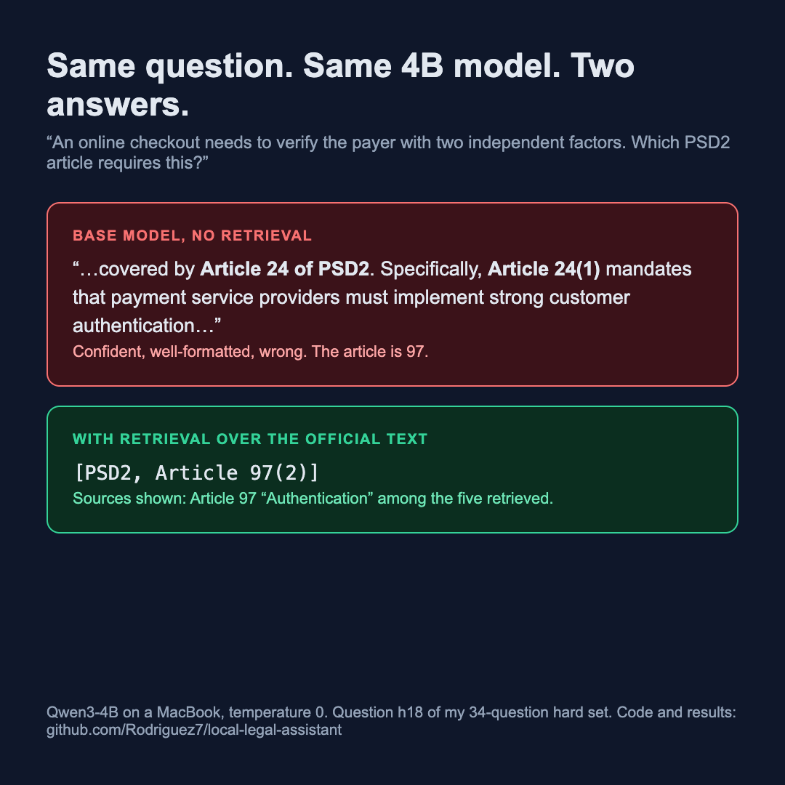

# legalrag

A private, fully local legal research assistant for EU financial and data law. It answers questions
from the official texts of the **GDPR, AI Act, PSD2, DORA, MiCA and the AML Regulation 2024/1624**,
cites the article it used, and runs on a laptop with no data leaving the machine.

Stack: Ollama (Qwen3-4B), Open WebUI, hybrid retrieval (embeddings + BM25), a FastAPI
OpenAI-compatible service, and an MLX LoRA fine-tune. Developed on an M1 Pro, 32 GB.

> Research support, not legal advice.

## Why

Small local models name the wrong article with confidence. The base model I started with labelled
GDPR Article 17 (erasure) as Article 15 (access). Grounding the answer in retrieved text fixes this,
and this repo measures by how much.



## Results

Each question asks which article of a named text covers a topic, so the answer is one article number.
Temperature 0, 74 questions: 40 "easy" (close to the article title) and 34 "hard" (a scenario, no
title words). Gold articles were never used for training.

| Setup | Correct article | Wrong article | Gold in top 5 |
|---|---|---|---|
| Easy: base model | 33% | 60% | n/a |
| Easy: base + RAG | 100% | 0% | 100% |
| Easy: fine-tuned + RAG | 100% | 0% | 100% |
| Hard: base model | 24% | 76% | n/a |
| Hard: base + RAG | 82% | 15% | 74% |
| Hard: fine-tuned + RAG | 76% | 24% | 74% |

What this shows:

- **RAG is what fixes hallucinated citations**: wrong-article answers drop from 60–76% to 0–15%.
- **The LoRA fine-tune fixed format, not correctness.** It cites with the exact label
  (`[GDPR, Article 17(1)]`) in 74 of 74 answers, against about 62% for base + RAG, which often
  wrote `[1]`. It did not improve accuracy: on the hard set it is 2 questions worse, which is within
  noise at n=34. Its answers are 2.5–4× longer (about 100 words).
- On the hard set the gold article is outside the top 5 for 26% of questions, so better retrieval
  is the next lever, not more fine-tuning.

Caveats, stated plainly: small question sets written by me; the "ungrounded citation" column in
`eval/results/*.json` over-counts cross-references that appear inside retrieved text; the fine-tuned
model is imported as `int4` while the baseline is `q4_K_M` (this Ollama build has no `q4_K_M` for
safetensors), so the comparison has a small quantisation confound. Raw per-question results are in
`eval/results/`.

Correction: my first baseline prompt ended with "e.g. Article 17" and the base model copied it, answering
"Article 17" for 53 of 74 questions (72% / 91% wrong). I removed the example and re-ran the baseline;
the numbers above are the corrected ones, and the original run is kept in `eval/results/anchored-prompt/`.

## How it works

```
Official Journal XHTML ──parse──▶ 2,031 chunks ("GDPR, Article 17(1): Right to erasure")
                                       │
        question ──▶ dense (nomic-embed-text) ┐
                 ──▶ BM25 (own implementation) ┴─ reciprocal rank fusion ─▶ top-5
                                                                              │
              system prompt + numbered sources ──▶ Qwen3-4B (Ollama) ──▶ cited answer
```

- Articles of 350 words or fewer are one chunk; longer ones split per numbered paragraph.
  Article counts for all six texts are checked against the official numbers
  (99 / 113 / 117 / 64 / 149 / 90). Annexes are not parsed yet.
- Dense search finds paraphrases ("right to be forgotten"); BM25 finds exact terms and article
  numbers. Rank fusion beats either alone on legal text.
- The service exposes `/v1/chat/completions` (streaming and not) and appends the retrieved sources
  to every answer, so Open WebUI shows what the answer rests on.

## Quick start

Requires Python 3.11+, [Ollama](https://ollama.com), and optionally Docker for Open WebUI.

```bash
ollama pull nomic-embed-text
ollama pull qwen3:4b-instruct-2507-q4_K_M

python -m venv .venv && .venv/bin/pip install -e ".[dev]"
legalrag fetch        # download the six texts from the Publications Office API (cached)
legalrag parse        # -> data/processed/chunks.jsonl
legalrag stats        # verify article counts
legalrag index        # embed the chunks (~1 minute)
legalrag search "right to be forgotten"
legalrag serve        # OpenAI-compatible API on :8000

docker compose up -d  # Open WebUI on http://localhost:3300 (model: "legalrag")
```

Reproduce the evaluation:

```bash
legalrag eval --mode base --label base
legalrag eval --mode rag  --label base+rag
legalrag eval --mode rag --questions hard --label hard-base+rag
legalrag report
```

## Fine-tuning (optional, Apple Silicon)

```bash
.venv/bin/pip install -e ".[train]"
# download Qwen/Qwen3-4B-Instruct-2507 into models/qwen3-4b-instruct-2507
legalrag build-data   # self-distilled training set (slow: ~240 local model calls x2)
legalrag split-data   # drop examples that would be truncated (see note below)
scripts/train.sh      # MLX LoRA, rank 8, 200 iterations
scripts/export.sh     # fuse adapter, import into Ollama as `legalrag-ft`
legalrag eval --mode rag --model legalrag-ft --label ft+rag
```

Training data is built by self-distillation with rejection sampling: the base model writes a
question for a provision, answers it with extra formatting instructions, and an example is kept only
if every citation is an exact label of a retrieved source. About 15% of examples pair a question with
unrelated sources and a refusal. Articles used by either evaluation set are excluded.

Note: with `--mask-prompt`, MLX returns a NaN loss if a prompt is longer than `--max-seq-length`
(truncation removes the answer). `split-data` filters those examples out.

## Layout

```
src/legalrag/   fetch, parse, retrieve, rag, api, evaluate, trainset, cli
eval/           question sets and per-question results
training/       generated training data
scripts/        train.sh, export.sh
tests/          unit tests (parser, BM25/RRF, API, harness, training data)
```

## Sources and licence

Code: MIT. Legal texts come from the EU Publications Office in their Official Journal version,
reusable under CC BY 4.0 (Commission Decision 2011/833/EU). The raw texts are fetched on demand and
are not stored in this repository.
